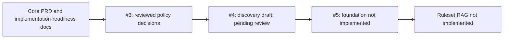
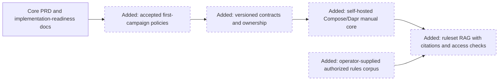
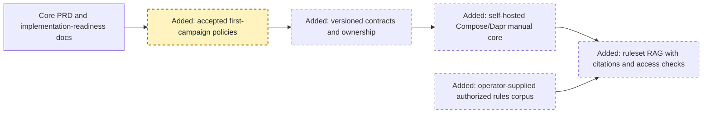
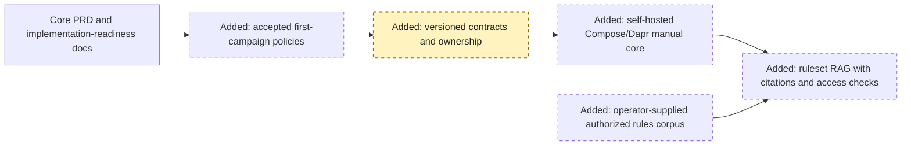
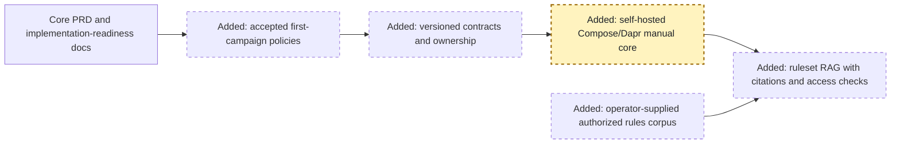
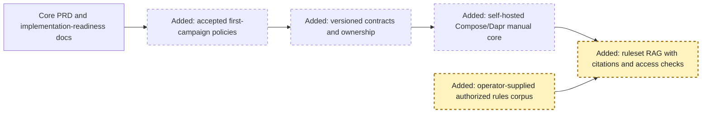

<!-- markdownlint-disable-file -->
# RPI Plan: MerlAIn Ruleset RAG MVP

## Task Metadata

* Task ID: MERLAIN-RULESET-RAG-MVP
* Task slug: ruleset-rag-mvp
* Plan date: 2026-11-12

## Executive Summary

* Bottom line: Plan a first MerlAIn retrieval-augmented-generation capability for one game ruleset, without claiming a complete rules engine.
* Why this matters: It gives a game master useful, source-grounded ruleset retrieval while preserving MerlAIn's access and content boundaries.
* Planning result: Blocked before foundation implementation. The user reviewed the policy record and architecture proposal, then confirmed that the campaign creator is its initial GM and that GM/Player are campaign-specific roles available to platform users. Complete technical contracts, prospective-owner reviews, and plan readiness remain outstanding.
* Confidence and uncertainty: The user-selected The One Ring 2e corpus, stated indexing/retrieval authorization, open-source usability requirement, and campaign policies are recorded. Detailed technical contracts remain unresolved; no rulebook content has been copied into the repository.

### What You May Not Know

* The root [README](../../../README.md) says this branch is specifications-only: the former application, runtime, and build tooling were removed. The [readiness guide](../../../docs/implementation-readiness.md) requires policy, contracts, and local foundations before implementation; old scaffold paths are not current architecture.
* The core PRD excludes a full rules engine and requires retrieval to stay within the requesting audience's authorized scope. It does not choose a rules corpus, RAG architecture, or implementation stack.
* Personal ownership of a rulebook does not by itself establish permission to reproduce or redistribute its content. The user explicitly confirmed authorization for indexing and retrieval of the identified local copy of The One Ring Core Rules (third printing); this is a user-provided authorization record, not an independent legal determination.
* The user wants MerlAIn to be usable by anyone as an open-source solution. This favors self-hostable defaults and provider-neutral contracts; it does not select a software license or permit packaging copyrighted rules.
* No root `LICENSE*` file is present. The project needs an explicit license decision before public distribution can be described as open source.
* The readiness issues remain open: [#3 policies](https://github.com/CoffeesoftDotDev/MerlAIn/issues/3), [#4 contracts and ownership](https://github.com/CoffeesoftDotDev/MerlAIn/issues/4), and [#5 local Compose/Dapr foundations](https://github.com/CoffeesoftDotDev/MerlAIn/issues/5). The user authorized preparation of these prerequisites, but their required human review/acceptance still gates #5 implementation.

## Phase Checklist

### Before

### After

The current checkout contains specifications and proposal drafts, not an
application runtime. The intended result is a reviewed policy and contract
baseline, a reproducible self-hosted manual-core foundation, and a ruleset RAG
feature that accepts operator-provided authorized content rather than
redistributing a game book.

<!-- rpi:phase id=P01 -->
### [ ] P01: Resolve first-campaign policy

Goals:
* Establish a decision-maker-reviewed policy record for identity, membership,
  campaign-specific GM/Player roles, and scene publication so later contracts
  do not encode unreviewed access rules.

Dependencies:
* The existing core PRD and issue #3 acceptance criteria.

Highlighted work: `policy` is the reviewed policy decision record; dashed
border and `Added:` label distinguish the policy record from the current
specifications-only baseline.

<!-- rpi:task id=P01-T01 -->
#### [ ] P01-T01: Finalize the first-campaign policy record

Goals:
* Record confirmed account, membership, campaign-creation, campaign-specific
  GM/Player role, and scene-publication policies for the later contract work.

Requirements:
* Issue #3 acceptance criteria; FR-CORE-001–008, FR-CORE-016–017, and
  FR-CORE-023–024.
* The record must name the decision-maker, distinguish confirmed decisions
  from proposals and unresolved items, include actor/action/content examples,
  and record the disposition of scene audiences, edits, history, and changed
  rights.
* A completed policy deliverable requires the decision-maker's review; a
  planner-authored recommendation alone is not acceptance.

Details:
* [docs/decisions/first-campaign-policies.md](../../../docs/decisions/first-campaign-policies.md)
  records choices accepted by the user, including campaign creation and
  campaign-specific GM/Player role eligibility. Do not close issue #3 before
  its remaining acceptance criteria are met.
* Keep private ideas, scene drafts, private sources, human-written journal
  entries, and published scenes distinct. Do not place game-rule text,
  credentials, or personal account data in the record.

References:
* [docs/decisions/first-campaign-policies.md](../../../docs/decisions/first-campaign-policies.md):
  accepted decisions and the remaining contract boundary.
* [Issue #3](https://github.com/CoffeesoftDotDev/MerlAIn/issues/3):
  required review and decision-record criteria.
* [Core PRD](../../squad/members/produit/prd/2026-09-28/merlain-prd-v0.1.md):
  FR-CORE-001–008, 016–017, and 023–024; R01/R02 and E01.

Dependencies:
* None.

<!-- rpi:phase id=P02 -->
### [ ] P02: Define first-campaign contracts and ownership

Goals:
* Give web, identity, campaign, and platform contributors a reviewable shared
  contract and exclusive file ownership so implementation can proceed without
  inventing incompatible APIs or data boundaries.

Dependencies:
* P01-T01 decision-maker review and acceptance of the policies consumed by
  the contracts.

Highlighted work: `contract` defines the approved boundaries consumed by
`foundation` and later application work.

<!-- rpi:task id=P02-T01 -->
#### [ ] P02-T01: Finalize first-campaign contracts and ownership

Goals:
* Specify the first GM/player workflow's service responsibilities, request and
  response contracts, authorization context, persistence ownership, and
  compatibility rules.

Requirements:
* Issue #4 acceptance criteria; FR-CORE-001–008, FR-CORE-023–024,
  FR-CORE-029–030, NFR-CORE-003, 006, 010, and 015; CON-CORE-001/002/006.
* The reviewed contract must preserve accepted #3 decisions, include
  positive/negative synthetic examples, identify the owner of every shared
  path and service schema, specify Dapr's first-slice interaction and failure
  behavior, and document local persistence and optional capability states.
* The candidate contract format is OpenAPI 3.1 with versioned HTTP interfaces,
  optimistic revisions, and no event infrastructure without a demonstrated
  asynchronous consumer. These are recommendations pending technical-owner
  review, not frozen choices.

Details:
* [docs/architecture/first-campaign/discovery.md](../../../docs/architecture/first-campaign/discovery.md)
  now records the reviewed-by-human candidate: web with same-origin
  backend-for-frontend, identity, and campaigns; synchronous Dapr invocation;
  no pub/sub by default; local PostgreSQL with service-owned schema/migrations;
  explicit ownership proposals, and the accepted campaign-specific GM/Player
  role model. Confirm or amend the technical choices and define the role-change
  interface before treating the document as an implementation contract.
* The discovery document includes synthetic policy-outcome fixtures for
  campaign roles, membership lifecycle, private content, audience snapshots,
  publication, revisions, and persistence failure. They are review examples,
  not executable tests or a frozen interface.
* A bounded `/api/v1` proposal for campaign creation and Player-to-GM role
  changes supplies candidate requests, responses, preconditions, and errors.
  The remaining interfaces and owner review are still required.
* [docs/architecture/first-campaign/campaign-api-v1.draft.yaml](../../../docs/architecture/first-campaign/campaign-api-v1.draft.yaml)
  extends that proposal with machine-readable campaign, invitation,
  membership-revocation, private-idea, draft-scene, and publication
  interfaces. Its OpenAPI structure and selected synthetic examples were
  checked locally. Invitation reuse, other membership and ownership
  transitions, Dapr research, and prospective-owner review remain open; the
  draft is not runtime implementation.
* [docs/architecture/first-campaign/identity-api-v1.draft.yaml](../../../docs/architecture/first-campaign/identity-api-v1.draft.yaml)
  proposes local sign-in, session inspection, and sign-out. Its OpenAPI
  structure, cross-document references, and selected synthetic examples were
  checked locally. Account registration, OIDC, administrator recovery,
  session operations, and owner review remain open; the proposal is not
  implemented authentication.
* Use only synthetic fixtures. A test stub must never ship as working
  authentication or successful persistence. Do not revive deleted scaffold
  paths or choose a framework solely from historical instructions.

References:
* [docs/architecture/first-campaign/discovery.md](../../../docs/architecture/first-campaign/discovery.md):
  current service, contract, Dapr/Compose, testing, and ownership proposal.
* [docs/architecture/first-campaign/campaign-api-v1.draft.yaml](../../../docs/architecture/first-campaign/campaign-api-v1.draft.yaml):
  incomplete, unapproved machine-readable campaign interface proposal.
* [docs/architecture/first-campaign/identity-api-v1.draft.yaml](../../../docs/architecture/first-campaign/identity-api-v1.draft.yaml):
  incomplete, unapproved local-session interface proposal.
* [Issue #4](https://github.com/CoffeesoftDotDev/MerlAIn/issues/4):
  contract, ownership, and technical review criteria.
* [docs/implementation-readiness.md](../../../docs/implementation-readiness.md):
  current specifications-only baseline and historical-path warning.
* [Core PRD](../../squad/members/produit/prd/2026-09-28/merlain-prd-v0.1.md):
  workflow scope, NFRs, constraints, and E10 technical discovery.

Dependencies:
* P01-T01.

<!-- rpi:phase id=P03 -->
### [ ] P03: Establish the local Compose/Dapr foundation

Goals:
* Provide a reproducible, durable, self-hosted runtime for the accepted manual
  campaign contracts so feature work can be developed and tested locally.

Dependencies:
* P02-T01 technical-owner review and acceptance of issue #4 contracts and
  ownership.

Highlighted work: `foundation` implements only the accepted contracts; it does
not implement campaign features or RAG behavior.

<!-- rpi:task id=P03-T01 -->
#### [ ] P03-T01: Build the accepted local runtime foundation

Goals:
* Start the accepted manual-core services locally with explicit readiness,
  persistence, configuration, and failure behavior.

Requirements:
* Issue #5 acceptance criteria; FR-CORE-001/029–030, NFR-CORE-003/004/012/015,
  and CON-CORE-001/002.
* The foundation must run through documented local Compose, use accepted
  service paths and Dapr components, preserve data across controlled restart,
  distinguish disabled/available/unavailable optional capabilities, and
  demonstrate one accepted Dapr contract exchange plus an explicit dependency
  failure.
* Local examples contain placeholders only; no real provider credentials,
  rulebook content, or destructive data-reset workaround.

Details:
* Issue #5 owns shared Compose/Dapr files, project scaffolding, startup and
  dependency manifests until ownership is handed to integration. Exact paths,
  schema boundaries, and startup behavior come from accepted issue #4
  contracts, not the current discovery proposal.
* Keep application services self-hosted. External OIDC or model providers
  remain optional configuration and do not become MerlAIn-hosted prerequisites.

References:
* [Issue #5](https://github.com/CoffeesoftDotDev/MerlAIn/issues/5):
  foundation scope and validation criteria.
* [docs/architecture/first-campaign/discovery.md](../../../docs/architecture/first-campaign/discovery.md):
  candidate ownership and runtime design, subject to acceptance.
* [docs/implementation-readiness.md](../../../docs/implementation-readiness.md):
  the current branch has no runtime implementation.

Dependencies:
* P02-T01.

<!-- rpi:phase id=P04 -->
### [ ] P04: Deliver the ruleset RAG MVP

Goals:
* Let a game master ask rules questions against an operator-supplied,
  rights-authorized ruleset and receive source-grounded answers without
  exposing content outside the caller's permitted scope.

Dependencies:
* P03-T01; the accepted application contracts and a supported model/provider
  configuration for the RAG capability.

Highlighted work: `corpus` is supplied by the operator under an appropriate
authorization; `rag` indexes and answers with citations while enforcing access.

<!-- rpi:task id=P04-T01 -->
#### [ ] P04-T01: Manage the operator-provided rules corpus

Goals:
* Allow the operator to add an authorized rules source and retain provenance
  needed to identify, refresh, or remove its derived index.

Requirements:
* FR-001, FR-004, NFR-002, and NFR-003.
* The application must not bundle the copyrighted The One Ring rules text or
  store it in version control, tests, logs, or generated project artifacts.
  The operator supplies a local source and is responsible for appropriate
  rights; the user's authorization statement is not an independent legal
  determination.
* Index metadata must identify the source and stable page/section provenance;
  deleting or replacing a source must make its stale derived segments
  unavailable to subsequent retrieval.

Details:
* The user identified The One Ring 2e Core Rules (third printing) and stated
  that indexing and RAG retrieval, including relevant excerpts, are
  authorized. Keep that source outside the repository. Support a
  provider-neutral ingestion boundary; exact file formats and extraction
  technology require bounded research before the implementation-ready plan
  and its critique. Validate the selected integration against the accepted
  foundation after it exists.

References:
* [Core PRD](../../squad/members/produit/prd/2026-09-28/merlain-prd-v0.1.md):
  FR-CORE-024 and NFR-CORE-006 access boundaries.
* [Session-memory PRD](../../squad/members/produit/prd/2026-09-28/merlain-session-memory-prd.md):
  source, rights, and provenance distinctions.
* [docs/implementation-readiness.md](../../../docs/implementation-readiness.md):
  open-source/self-hosting and current runtime constraints.

Dependencies:
* P03-T01.

<!-- rpi:task id=P04-T02 -->
#### [ ] P04-T02: Retrieve and answer with authorized source evidence

Goals:
* Return helpful ruleset answers that are grounded in retrieved passages and
  make the supporting source locations visible to the user.

Requirements:
* FR-001, FR-002, FR-003, NFR-001, and NFR-002.
* Every substantive answer must provide resolvable source citations or state
  that the indexed rules do not provide enough evidence. Do not invent a rule,
  assert a citation that does not resolve, or claim full rules adjudication.
* Apply authorization before retrieval and before returning passages or
  derived output. Unauthorized, revoked, stale, or cross-campaign material
  must not be exposed through search results, citations, logs, or responses.

Details:
* Preserve the PRD boundary that campaign, source, and audience permissions
  apply to derived search/RAG output. Use a provider-neutral model/embedding
  contract and keep all remote providers optional. A local model endpoint is
  the preferred open-source/self-hosting recommendation; compare feasibility,
  licensing, and deployment requirements before selecting a concrete model.
* The model/provider, embedding choice, retrieval quality threshold, and
  evaluation corpus are evidence gaps; resolve the planning choices with
  bounded research before the initial critique, then validate integration
  against the foundation after issue #5. Do not invent performance claims.

References:
* [Core PRD](../../squad/members/produit/prd/2026-09-28/merlain-prd-v0.1.md):
  FR-CORE-024, NFR-CORE-006, and manual/optional capability constraints.
* [docs/decisions/first-campaign-policies.md](../../../docs/decisions/first-campaign-policies.md):
  campaign access and publication policies that retrieval must preserve.

Dependencies:
* P04-T01.

<!-- rpi:task id=P04-T03 -->
#### [ ] P04-T03: Integrate and validate the GM RAG workflow

Goals:
* Provide an accessible manual workflow for adding a question, reviewing a
  cited response, and following its sources without requiring optional AI for
  unrelated campaign work.

Requirements:
* FR-002, FR-003, FR-004, FR-005, NFR-001, NFR-002, NFR-003, NFR-004,
  and NFR-005.
* The workflow must remain self-hostable and usable without a MerlAIn-hosted
  application service. AI/provider unavailability must produce an explicit
  failure and must not block unrelated manual campaign workflows.
* Validate allowed and denied retrieval, missing/ambiguous evidence,
  source-version changes, model/provider failure, and source citation
  integrity using synthetic fixtures or authorized local test material only.
* Meet the PRD's WCAG 2.2 AA accessibility target without claiming
  certification.

Details:
* Fit the UI and endpoint into the accepted issue #4 boundaries. Keep source
  text and prompts out of default logs; use visible citations and synthetic
  evaluation fixtures. Select an evaluation threshold only after evidence
  establishes a defensible baseline.

References:
* [Core PRD](../../squad/members/produit/prd/2026-09-28/merlain-prd-v0.1.md):
  NFR-CORE-004/006/008/010/015 and FR-CORE-029.
* [docs/architecture/first-campaign/discovery.md](../../../docs/architecture/first-campaign/discovery.md):
  accepted contract and ownership boundaries after review.
* [README](../../../README.md):
  repository's current specifications-only state.

Dependencies:
* P04-T02.

## User Decisions and Requirements

### Confirmed User Direction

* Deliver a first MVP for RAG capabilities over a game ruleset.
* The user has requested implementation and autonomous continuation. Required human reviews, accepted contracts, and the implementation-ready plan and critique gates still apply.
* Use The One Ring 2e for the first MVP; the user identified a local copy of its Core Rules (third printing) as the candidate corpus and confirmed explicit authorization for machine indexing and RAG retrieval, including relevant excerpts.
* Work through issues #3, #4, and #5 before implementing the RAG MVP; do not create a separate local prototype.
* Make the solution usable by anyone as an open-source product, favoring self-hostable defaults and provider-neutral contracts. This does not imply that game-rule content can be redistributed.
* While the user is unavailable, make evidence-based planning recommendations for later review; this does not waive issue-required human review or acceptance.

### Planning Decisions and Feedback

| Group | Decision or feedback item | Status | Owner | Rationale or input needed | Evidence | Planning impact |
|---|---|---|---|---|---|---|
| D1 | Authorization to index and retrieve from the candidate The One Ring 2e Core Rules corpus | Confirmed by user | User | The user explicitly confirmed authorization for machine indexing and RAG retrieval, including relevant excerpts. This is not an independent legal determination. | User answer in this session; [core PRD](../../squad/members/produit/prd/2026-09-28/merlain-prd-v0.1.md), E05 | Keep the local source outside version control and do not redistribute its text. |
| D2 | Sequence the RAG MVP with shared readiness issues | Confirmed: proceed with #3, #4, and #5 before RAG implementation | User | Shared policy, contracts, and local foundation must precede application work. | User request in this session; [issue #3](https://github.com/CoffeesoftDotDev/MerlAIn/issues/3), [issue #4](https://github.com/CoffeesoftDotDev/MerlAIn/issues/4), [issue #5](https://github.com/CoffeesoftDotDev/MerlAIn/issues/5) | Prepare the prerequisite records; issue-required human review/acceptance remains a gate before #5. |
| D3 | Decision participation while user is unavailable | Confirmed: prepare evidence-based recommendations autonomously for later human review | User | Keeps work moving without presenting unreviewed recommendations as approved policy. | User message in this session | Agent may draft proposals; issue-required human review is retained. |
| D4 | Open-source usability | Confirmed: make MerlAIn usable by anyone as an open-source solution | User | Favor self-hostable defaults and provider-neutral contracts; this does not select a license or authorize redistribution of game text. | User message in this session; current readiness docs | Treat hosted MerlAIn services as optional; keep licensing and corpus rights distinct. |
| D5 | Scene-publication defaults | Accepted by the user: GM-only publishing to a publication-time snapshot audience, explicit republishing, and suspending a projection after a source/right change | User | The user reviewed the policy record and accepted its existing choices. | [Policy record](../../../docs/decisions/first-campaign-policies.md); user message in this session | Preserve these policies in the final contracts and fixtures. |
| D6 | First-campaign technical architecture | User reviewed the web/backend-for-frontend, identity and campaigns proposal with synchronous Dapr, OpenAPI 3.1, and local PostgreSQL | User review; technical contract and owner review pending | The discovery document still has illustrative schemas and unresolved technical details; one user review does not evidence the prospective-owner reviews required by #4. | [Architecture discovery](../../../docs/architecture/first-campaign/discovery.md), issue #4, CON-CORE-001/002/006 | Complete concrete contracts and obtain required owner reviews before #5. |
| D7 | Repository open-source license | Unresolved; no root `LICENSE*` file exists | User | Public open-source distribution requires an explicit license choice; selecting one has legal and reuse consequences. | Workspace root inspection; user open-source requirement | Do not add a license or claim a release is open source until the user reviews and selects one. |
| D8 | RAG model, embeddings, and evaluation threshold | Pending bounded technical research before the implementation-ready plan and initial critique; runtime integration validation follows #5 | Agent | No evidence currently supports a specific provider, model, embedding strategy, or quality threshold. | Core PRD E10; no runtime in this branch | Use provider-neutral contracts and a local-model recommendation; do not make Foundry or a hosted provider mandatory. |
| D9 | Progression after the user's implementation request | Confirmed: continue autonomously through implementation and Review when eligible | User | Required human-review, contract, and critique gates remain in force. | User message in this session | Automatic progression through Review. |
| D10 | Review of the existing policy and architecture drafts | User reviewed both and requested implementation | User | This accepts the policy choices then present and reviews the architecture proposal; it does not establish the separate prospective-owner reviews or complete illustrative contracts. | User: “Looks good to me, go ahead with implementation”; [policy record](../../../docs/decisions/first-campaign-policies.md); [architecture discovery](../../../docs/architecture/first-campaign/discovery.md) | Preserve the accepted policies and advance #4 contract preparation without claiming its review gates passed. |
| D11 | Campaign creation and GM/Player role eligibility | Any platform user can create a campaign and becomes its initial GM; any user may hold GM or Player roles per campaign, and a Player may become GM through the authorized campaign role-change process. The reviewed policy proposal retains the creator as initial owner. | User-confirmed role eligibility; ownership proposal retained | The user clarified that a campaign's GM is a platform user who created the campaign and that any user can be GM or Player in a campaign. Existing direction keeps subsequent GM role changes under an existing campaign GM. | User message 2026-11-13; FR-CORE-005; [policy record](../../../docs/decisions/first-campaign-policies.md) | Encode the campaign-specific role model in the #4 contracts; do not model GM as a global installation privilege. |

## Planning Readiness and Next Step

| Field | Record |
|---|---|
| Planning execution and readiness | Partial; the user reviewed the existing policy and architecture drafts and confirmed the campaign-specific GM/Player role model. Complete contracts, prospective-owner reviews, and technical evidence gaps prevent implementation readiness. |
| Decision participation | Automatic progression through Review; planning recommendations are agent-owned, while the previously retained human review and required issue acceptance gates remain in force. |
| Blockers | Issue #4 lacks complete contracts and required review from prospective identity, campaign, and UI owners; issue #5 depends on #4 acceptance. Platform/integration review is recommended for the handoff. Required research is incomplete after access to its research template was denied. A license decision is a separate gate for public open-source distribution. |
| Latest critique | Not run; the plan is not implementation-ready and technical-owner review gates are unresolved. |
| Relevant research | Core PRD, session-memory PRD, readiness guide, issue criteria, and repository state establish the current boundary. RAG provider, model, ingestion format, and evaluation planning need evidence before the initial critique; integration validation follows #5. |
| Plan | `.copilot-tracking/plans/2026-11-12/ruleset-rag-mvp-plan.md` |
| Changes-record role | `.copilot-tracking/changes/2026-11-12/ruleset-rag-mvp-changes.md` will be implementation evidence if implementation is approved. |
| Continuation owner | Automatic RPI Agent, preparing contract evidence while required decisions and reviews remain pending. |
| Required gates or confirmations | The user reviewed the policy and architecture drafts, including D5, and confirmed D11. Complete issue #4 technical contracts and obtain prospective-owner reviews before #5. Select an open-source license before public distribution. Resolve RAG-specific evidence and complete the initial critique before implementation. |
| Next action | Identify the prospective reviewers and complete the #4 contract proposal without retrying or bypassing the denied research-template access. Continue Plan to implementation readiness and its initial critique without entering Implement before the gates pass. |

## Goals

* Provide a usable first RAG capability grounded in The One Ring 2e rules text.
* Preserve source provenance and the retrieval access boundary already specified for MerlAIn.
* Keep the software self-hostable and usable as an open-source solution without requiring a MerlAIn-hosted service.
* Return source-grounded answers with resolvable citations or an explicit insufficient-evidence response.

## Scope and Non-Goals

### In Scope

* Resolve the shared policy, contract, and local-foundation prerequisites in issues #3–#5 before RAG feature implementation.
* Plan a production MVP for The One Ring 2e using the user-authorized Core Rules corpus after the accepted contracts and foundation are available.
* Allow operators to provide their own authorized rulesets without bundling copyrighted game text.
* Keep model/provider integrations replaceable and optional for non-AI manual workflows.

### Non-Goals

* A complete rules engine, automated character validation, or rules adjudication.
* Session-memory audio transcription, Graphiti campaign memory, Storyteller summaries, or orchestration.
* Indexing multiple rulesets before the first MVP boundary is agreed.
* A separate non-production local prototype.
* Recreating the removed application scaffold or asserting a framework or service architecture not selected by the technical owner.
* Selecting a software license or redistributing the ruleset on the user's behalf.

## Functional Requirements

* FR-001: An operator can add one authorized game-rules corpus, initially the user-selected The One Ring 2e Core Rules.
* FR-002: A GM can ask a question against the configured ruleset and receive retrieved source material relevant to that query.
* FR-003: Every substantive answer includes resolvable source citations or clearly states that the indexed source does not provide enough evidence; the feature is not a full rules engine.
* FR-004: Retrieval, excerpts, sources, and derived responses remain within the requesting user's authorized scope, consistent with FR-CORE-024.
* FR-005: The RAG capability runs within the accepted self-hosted application boundaries and does not require a MerlAIn-hosted application service or a single proprietary model provider.

## Non-Functional Requirements

* NFR-001: No unauthorized or cross-campaign content is exposed through retrieval or derived output.
  * Objective threshold or evaluation condition: zero unauthorized results in the defined allow/deny test corpus; this is not an absolute security guarantee outside that corpus.
* NFR-002: Source provenance remains usable throughout ingestion, retrieval, update, and removal.
  * Objective threshold or evaluation condition: every returned citation resolves to the current indexed source; after a source is removed or replaced, no stale segment is returned in subsequent requests.
* NFR-003: User-provided rulebook content is not redistributed or exposed through repository artifacts, logs, or unrelated provider calls.
  * Objective threshold or evaluation condition: repository/test fixtures contain no game-book text; content-deletion and logging checks confirm no stale derived content is returned or logged by default.
* NFR-004: Manual campaign workflows remain usable when the optional RAG/model provider is disabled or unavailable.
  * Objective threshold or evaluation condition: run manual-core tests with the provider disabled and unavailable; unrelated campaign operations succeed and RAG reports an explicit failure.
* NFR-005: The RAG interaction is accessible to the PRD's WCAG 2.2 AA target.
  * Objective threshold or evaluation condition: keyboard, visible focus, labels/errors, status announcements, contrast, zoom, and 320px reflow checks pass for the defined workflow; no certification claim.

## Risks and Open Questions

| Priority | Type | Risk, question, or planning item | Affected work | Impact | Smallest action or evidence needed | Owner |
|---|---|---|---|---|---|---|
| High | Dependency | #4 lacks complete contracts and required prospective-owner reviews; #6, #7, and #8 have no assignees, and the platform/integration reviewer is also not identified. The checkout has no application runtime. | P02-T01, P03-T01 | Building the foundation before policy/contract acceptance risks encoding unapproved access or architecture choices. | Complete #4 and obtain the required identity, campaign, and UI owner reviews; platform/integration review is recommended for the handoff. | Prospective issue owners |
| High | Evidence gap | Required research-template access for Dapr invocation and local hosting was denied. | P02-T01, P03-T01 | The supporting technical research is incomplete and its denial cannot be retried or bypassed. | Resolve the access blocker without repeating the denied action; retain the incomplete evidence boundary. | RPI session |
| High | Ownership conflict | The campaign-service candidate assigns membership and role records to campaigns, but [issue #6](https://github.com/CoffeesoftDotDev/MerlAIn/issues/6) assigns membership administration to identity and [issue #7](https://github.com/CoffeesoftDotDev/MerlAIn/issues/7) excludes it from campaign ownership. | P02-T01, P03-T01 | The services could implement conflicting authorities and revocation semantics. | Recommend identity ownership to align with the issues; prospective identity and campaign owners must review the store, command and authorization boundaries, including creation failure recovery, before #4 acceptance. | Prospective identity and campaign owners |
| High | Open question | No repository license is declared, and the user has not selected one. | P03-T01 and P04-T03 | The project cannot make a clear open-source distribution claim until licensing is resolved. | User selects a license after reviewing its scope and consequences. | User |
| Medium | Open question | The precise contract for changing a campaign member's role and how a campaign can have multiple GMs is not fully specified. | P02-T01 | The policy establishes per-campaign role eligibility and existing-GM authorization, but concrete role-change and last-GM transition contracts must preserve those rules. | Define and review the role-change contract with prospective campaign and identity owners. | Prospective owners |
| Medium | Open question | Invitation reuse, already-current-member redemption, rejoining after revocation, and owner departure while other GMs remain are unspecified. | P02-T01 | Wire contracts and atomic lifecycle handling cannot be frozen without these decisions. | Resolve the affected policy and interface cases with prospective owners before contract acceptance. | Prospective owners |
| Medium | Further planning | RAG model/embedding provider, ingestion format, quality baseline, and evaluation set are not supported by current evidence. | P04-T01, P04-T02, P04-T03 | A premature choice may exclude self-hosted deployments or make quality claims without evidence. | Research the planning choices before the initial critique; validate integration after #5 using a small authorized/synthetic evaluation corpus. | Planner |

## Dependencies

* User-identified The One Ring 2e Core Rules corpus and explicit authorization confirmation: available for the later technical plan; keep the local source outside version-controlled project files.
* Technical contracts and local foundations: needed to choose compatible application boundaries, runtime, storage, and reproducible validation.
* User review of issue #3 is recorded; technical-owner acceptance of issue #4 is required before issue #5 implementation.
* A user-selected open-source license: required before public distribution under an open-source claim.

## Sources

* [README](../../../README.md): confirms that the current branch has no application code, runtime, or build tooling.
* [Implementation readiness](../../../docs/implementation-readiness.md): identifies policy, technical-contract, and foundation prerequisites before implementation.
* [Core PRD](../../squad/members/produit/prd/2026-09-28/merlain-prd-v0.1.md): FR-CORE-024 and NFR-CORE-006 define retrieval authorization boundaries; CON-CORE-001/002 and E05/E10 constrain implementation readiness; section 10 excludes a complete rules engine.
* [Session-memory PRD](../../squad/members/produit/prd/2026-09-28/merlain-session-memory-prd.md): distinguishes campaign-memory RAG from ruleset retrieval and records source, rights, and provenance as unresolved.
* [Issue #3 policy record](../../../docs/decisions/first-campaign-policies.md): user-reviewed identity, campaign creation, campaign-specific role, membership, and publication policies.
* [Issue #4 architecture discovery](../../../docs/architecture/first-campaign/discovery.md): proposed ownership, contracts, Dapr/Compose choices, and open technical review items.
* User-provided corpus reference: a local copy of The One Ring Core Rules (third printing); the user explicitly confirmed authorization for machine indexing and RAG retrieval, including relevant excerpts. Source path and book content are intentionally not copied into this plan.
* Live issue status checked during planning: [#3](https://github.com/CoffeesoftDotDev/MerlAIn/issues/3), [#4](https://github.com/CoffeesoftDotDev/MerlAIn/issues/4), and [#5](https://github.com/CoffeesoftDotDev/MerlAIn/issues/5) are all open. The user directed that production planning begin after these issues are resolved.

## Critique Disposition

* Critique candidate identity: MERLAIN-RULESET-RAG-MVP; initial scoping state, not an implementation-ready candidate.
* Critique depth and provenance: Standard; default.
* Critique execution: Not run; unresolved material decisions prevent readiness.
* Initial attempt consumed: No.
* Recovery attempt consumed: No.
* Attempt provenance: Not applicable.
* Recovery eligibility and consent: Not applicable.

## Artifact Self-Check

* [x] Executive Summary, What You May Not Know, and Phase Checklist precede supporting sections.
* [x] Confirmed direction, the campaign-specific GM/Player role model, unresolved license and model choices, readiness, scope, requirements, risks, and dependencies are recorded.
* [x] Every active phase has Goals, Dependencies, and a phase diagram; every task has Goals, Requirements, Details, References, and Dependencies.
* [x] All FR and NFR identifiers are cited by at least one task.
* [x] Before, After, and phase diagrams use stable node IDs and the prescribed font initialization; new nodes retain dashed borders and phase highlights have explicit text colors.
* [x] Rights, human-review, and issue sequencing blockers are stated without treating proposals as accepted.
* [ ] Dual-theme Mermaid rendering was not verified in this workspace.
* [ ] Implementation readiness and initial critique remain pending issue #4 owner review and bounded RAG-specific research.
* [ ] A license decision remains necessary before public open-source distribution.
* Checked sections: task identity, phase/task IDs, scope, requirements, links, dependencies, issue criteria, and human-review boundaries.
* Missing or limited sections: concrete RAG provider/evaluation evidence, open-source license, and dual-theme diagram rendering.

## Follow-Up Items

* None.

## Handoff

* Implementation handoff is not ready. The user reviewed the policy and architecture proposal and confirmed campaign-specific GM/Player role eligibility. Complete issue #4 contracts, prospective-owner reviews, required research, and the initial critique remain outstanding. A license decision is separately required before public open-source distribution.
